# Semantic Voxels: Keyframe-Reprojected Visual Voxel Field

[](https://docs.ros.org/)


**Languages:** [English](README.md) | [中文](README_CN.md)

> A source-aware semantic voxel world for robots that need to act.

> A way for robots to express, remember, and reason about the world they perceive.

> A relatively high-performance real-time mapping method under limited compute.

Semantic Voxels is a semantic voxel world representation framework for edge mobile manipulation robots. It is not another point-cloud viewer, and it is not just `OctoMap + YOLO` taped together. It tries to answer a question that sits much closer to robot action:

**After a robot sees the world, how should it remember it, explain it, query it, and still know where to act when the sensor fails?**

Traditional mapping systems usually optimize for geometric reconstruction: a more complete map, a smoother surface, a smaller reconstruction error. Semantic Voxels aims at a different target. For mobile manipulation, it reorganizes the map into a queryable, explainable, source-aware, time-aware task state field.

In plain words: Semantic Voxels does not just give a robot a map that “looks like the world.” It gives the robot something closer to a Minecraft-like world representation: the scene in front of the robot becomes a state space that behavior trees, grasp modules, and task systems can directly consume.

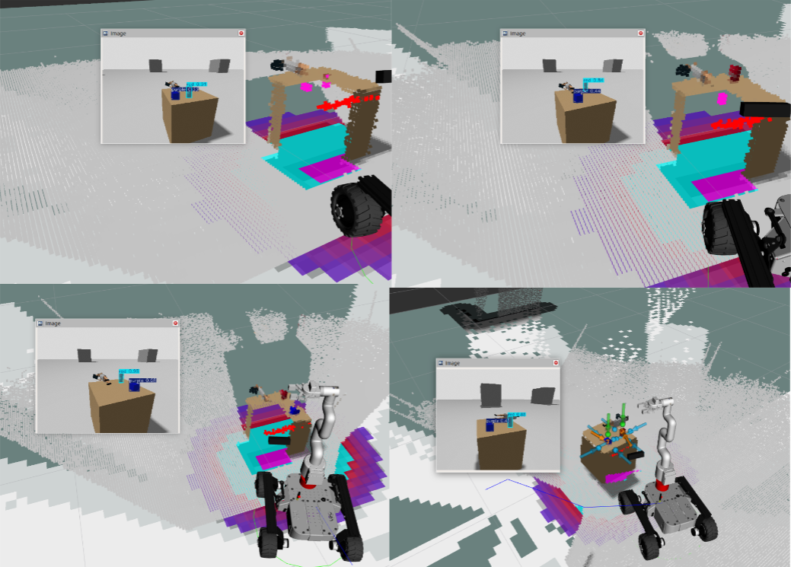

---

## Technical Report

The technical report frames Semantic Voxels as a source-aware semantic voxel world representation for edge mobile manipulation.

Main topics include:

- Semantic Voxels world representation
- source-aware voxel state
- observed-hypothesis separation
- map-prior and depth-failure handling
- task-level object and grasp queries
- decoupled ROS 2 integration

Related file:

- [`SEMANTIC_VOXELS_TECHNICAL_REPORT_DRAFT.pdf`](docs/SEMANTIC_VOXELS_TECHNICAL_REPORT_DRAFT.pdf)

If you are interested in the method behind the demo, the technical report is the place to look. A more formal paper is planned for future work.

---

## What Semantic Voxels Does

Semantic Voxels fuses information from RGB-D cameras, TF/pose, semantic detection, and depth-repair modules into a sparse semantic voxel field. Each voxel stores more than `occupied / free`. It can also store:

- occupancy log-odds
- color and appearance state
- semantic label and confidence
- temporal freshness
- evidence source
- observed / repaired / hypothesis / uncertain state

This means the robot does not only know “there is something here.” It can also ask:

- Did the depth camera really observe this, or was it inferred from semantic prior?
- Is this observation fresh, or is it a stale remnant?
- Can this region be used as a grasp candidate?
- Can a behavior tree or manipulation pipeline query this object directly?

Semantic Voxels also does not rely on RGB texture to build geometry. As long as depth is valid, it can keep building a 3D voxel map in low-light or weak-texture environments. In this system, RGB is more like a useful bonus channel for color and semantics, not the only thing holding the map together.

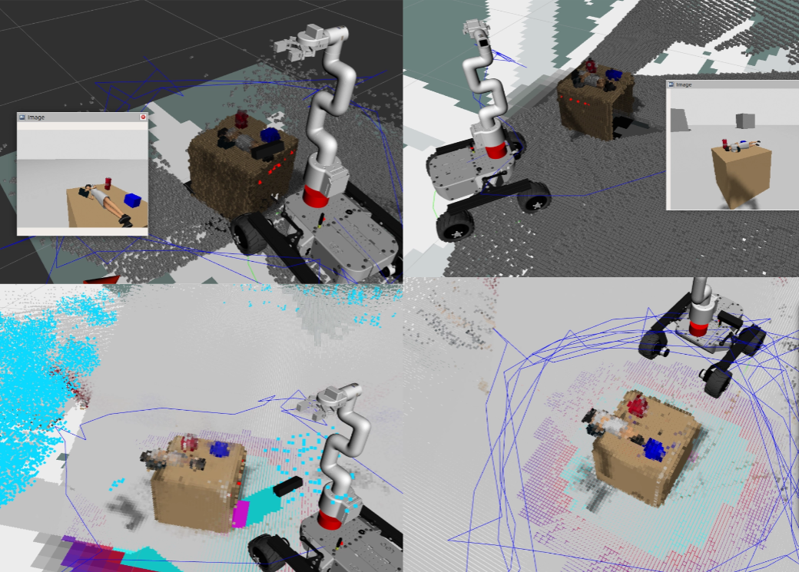
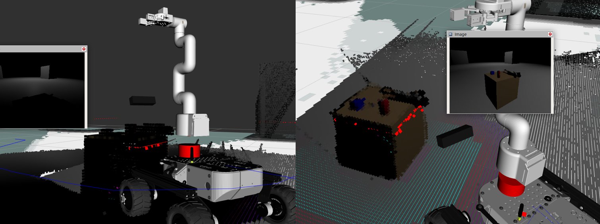
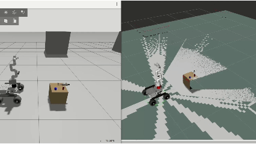

---

## How It Differs from Traditional Point Clouds / RTAB-Map Clouds

Traditional point clouds and systems such as RTAB-Map are extremely useful. They are good at RGB-D SLAM, camera pose estimation, loop closure, map stitching, and scene-level point-cloud reconstruction. In other words, they mainly answer questions like:

```text
Where am I?
Which places have I seen?
Can these observations be assembled into a geometric map?
```

Semantic Voxels asks a different question:

```text
What can the robot act on right now?
Is this target reliable?
Was it observed, repaired, or hypothesized?
Can it still be grasped?
Can a behavior tree query it directly?
```

A point cloud is usually a collection of geometric observations. It can be dense and faithful, but downstream modules still need to find objects, handle freshness, attach semantics, and generate grasp candidates on their own. Semantic Voxels organizes the space behind those observations into a voxel world state, where each voxel can carry source, semantic, temporal, and task meaning.

So Semantic Voxels is not trying to replace RTAB-Map. The cleaner relationship is:

- RTAB-Map / SLAM can provide pose and global mapping context.
- PointCloud2 can provide raw geometric observations.
- Semantic Voxels organizes those observations into a semantic voxel world that robots can query and act on.

If RTAB-Map is closer to a robot's spatial memory, Semantic Voxels is closer to its task workbench: it does not merely store the world; it prepares the world for grasping, querying, waiting, and updating.

To be fair, it still does look a lot like a point cloud...

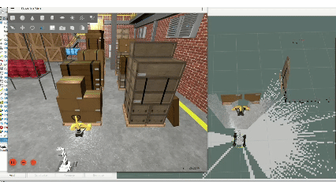

---

## Core Idea

The core idea of Semantic Voxels is:

> Robots should not only reconstruct geometry. They should maintain a source-aware, queryable world state that supports action.

RGB-D depth often fails on transparent, reflective, glossy, dark, or thin objects. A traditional occupancy mapper may treat the target region as free space and carve it away. Semantic Voxels does not merge this failure into ordinary geometry. Instead, it maintains an explicit observed / hypothesis separation:

- **Observed layer**: geometric occupancy maintained from real depth and reliable observations.
- **Hypothesis layer**: task hypotheses generated when depth fails but semantic evidence exists.
- **Query layer**: object and grasp queries exposed to the robot.

This allows the robot to keep a grasp candidate that it can still act on during depth failure, while avoiding silent corruption of the persistent geometric map.

I believe future versions of Semantic Voxels can develop better ways to recover depth-failure regions. So far, I have tested YOLO-guided semantic depth recovery and block-style completion inside depth-failure regions. Both show useful effects, especially for broad top-grasp behaviors with a manipulator.

Of course, there are still many directions worth exploring, including 3D navigation.

---

## Minecraft, but for Robots

Semantic Voxels looks a bit like Minecraft. That is not an accident; it is part of the inspiration.

Put differently, a robot does not always need an infinitely detailed, infinitely smooth world. For many manipulation tasks, a block world is already enough for the robot to understand what is in front of it.

Maybe one day, if robots really start to “feel” the world, they might actually prefer this kind of blocky, editable, queryable representation. Who knows. The robots may have taste.

A block-based voxel world gives a very direct representation of the scene: discrete, queryable, updateable, erasable, and naturally consumable by higher-level task systems.

In this sense, Semantic Voxels turns the RGB-D world seen by the robot into a programmable block world:

- observed geometry can become stable blocks;
- depth-failure regions can produce explicit hypothesis blocks;
- stale object remnants can be dynamically cleared;
- semantic targets can be queried;
- grasp candidates can be generated from voxel structure;
- behavior trees and manipulation pipelines can connect through ROS interfaces;
- and future developers can build more “gameplay” on top.

This is the fun part of Semantic Voxels’s decoupled design: the mapper maintains the world state, but it does not hard-code the robot’s behavior. Future developers can attach navigation, grasping, search, interaction, task planning, VLM policies, or new behavior-tree logic on top of the same world representation.

In other words, Semantic Voxels tries to give robots a kind of “creative mode” base world:

**The map is no longer just a map. It becomes a programmable world substrate where robot behavior can keep growing.**

<p align="center">
  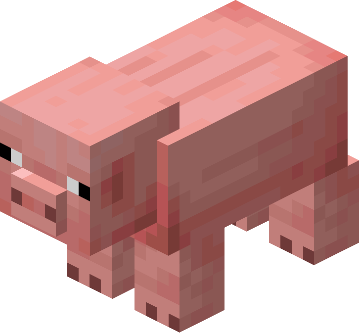
  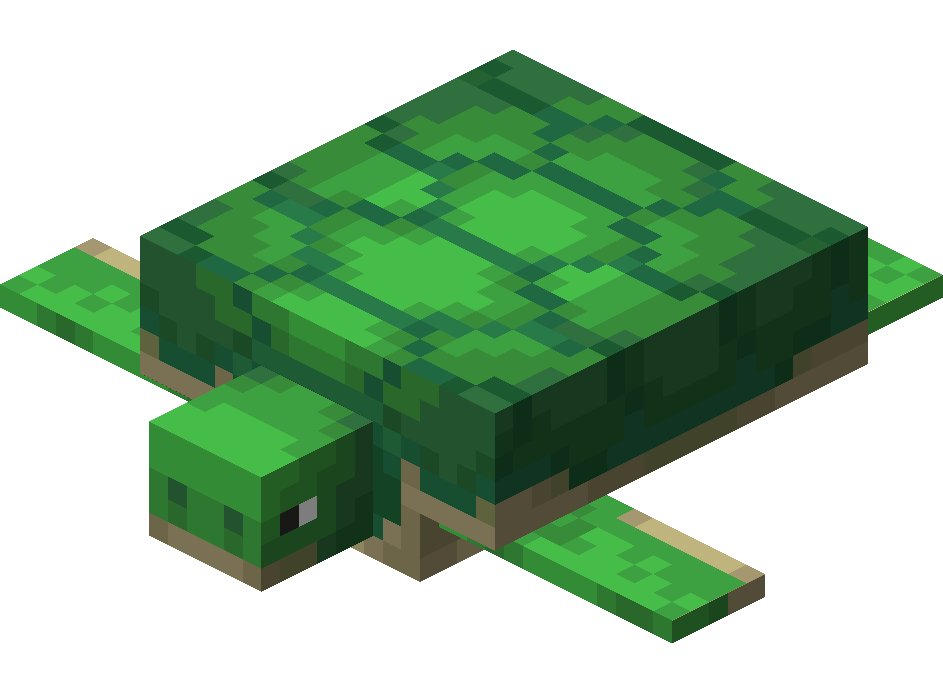
</p>

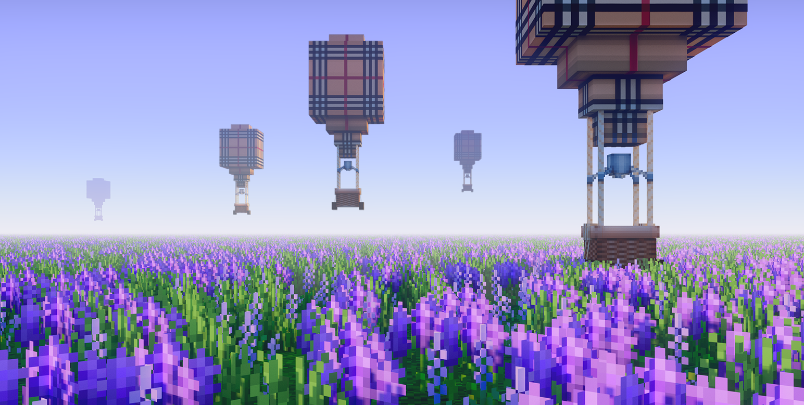

---

## Main Features

### Source-Aware Semantic Voxels

A Semantic Voxels voxel is not just an occupancy cell. It is a task-state unit:

```text
voxel = occupancy + color + semantic evidence + confidence + freshness + source type
```

This lets the map express why the system believes something exists, not just whether something exists.

### Observed-Hypothesis Separation

Semantic Voxels maintains real observations and semantic hypotheses separately. Semantic evidence can help the robot form a grasp candidate during depth failure, but it does not automatically rewrite the measured geometric map.

This is one of the most important design choices in Semantic Voxels:

**Semantic priors can support action, but they should not quietly pollute the observed map.**

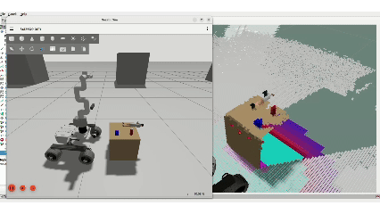

### Depth-Failure-Aware Semantic Completion

For intentionally created depth-failure regions, manually removed depth inside YOLO detection boxes, or missing depth on transparent and reflective objects, Semantic Voxels can generate explicit semantic hypotheses and expose them as queryable task targets.

It represents “I did not physically see this, but semantic evidence suggests there may be a target here” as an explicit state, instead of pretending it is ordinary geometry.

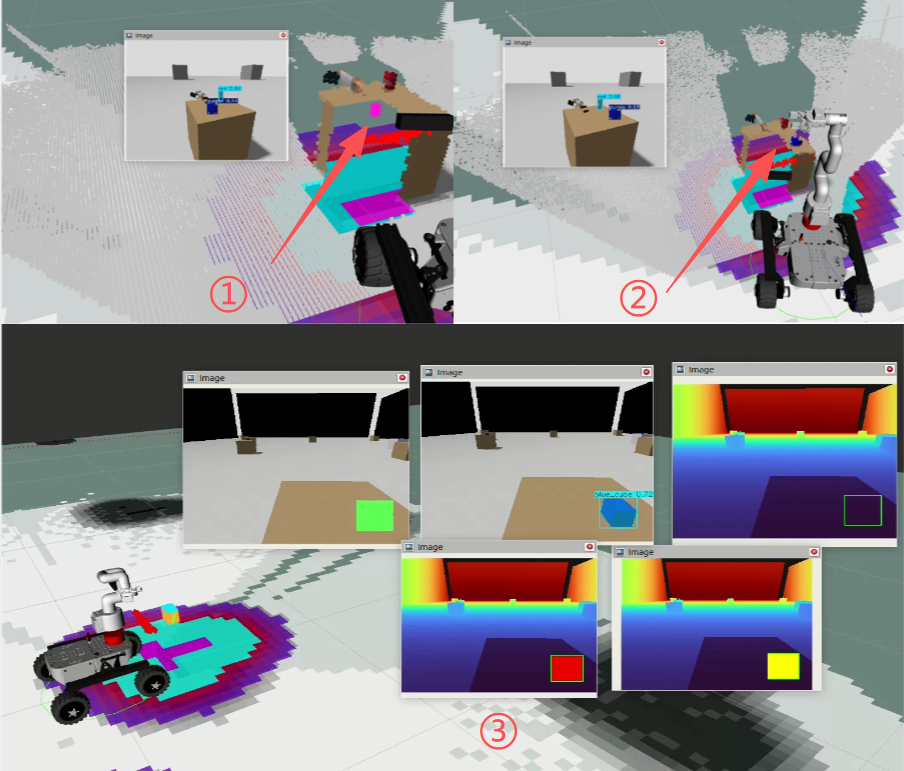
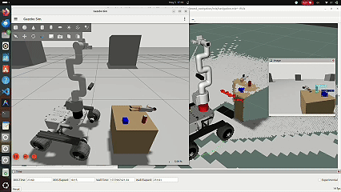

### Task-Level Object and Grasp Queries

Semantic Voxels does not force downstream modules to parse raw point clouds by themselves. It directly exposes:

- semantic object query
- grasp candidate query
- wait-for-object action
- grasp candidate visualization markers
- object pose bridge

The robot can ask:

```text
Where is the red block?
Is it stable enough?
Give me grasp candidates.
Wait until the target appears.
```

So yes, it can do quite a few useful things.

Semantic Voxels is closer to a robot memory server than a passive map publisher.

Here is a small demo: Semantic Voxels can assign candidate grasp poses based on the pose and structure of a voxel block cluster, score each candidate, and choose a preferred grasp.

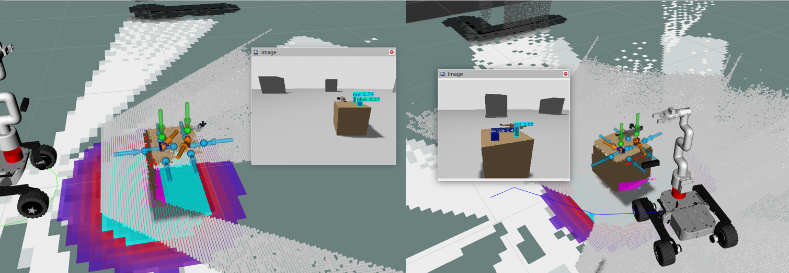
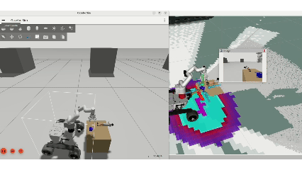
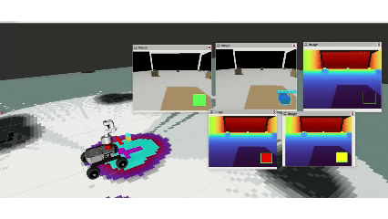

### Decoupled ROS 2 Integration

The Semantic Voxels mapping core is not tied to a specific robot, arm, YOLO model, MoveIt pipeline, or behavior tree.

As long as a robot provides:

- RGB-D images
- camera calibration
- TF / pose transform
- ROS 2 topic / service / action interfaces

it can connect to the same Semantic Voxels world model. Robot-specific logic is attached through bridge nodes instead of being hard-coded inside the mapper.

---

## System Architecture

```text
RGB-D Camera + TF/Pose
        |
        v
Semantic Voxels Sparse Voxel Mapping Core
        |
        +--> observed voxel layer
        +--> free-space evidence
        +--> semantic hypothesis layer
        +--> map-prior depth
        |
        v
Task-Level Query Interface
        |
        +--> /semantic_voxels_cpp/query_object
        +--> /semantic_voxels_cpp/query_grasp_candidates
        +--> /semantic_voxels_cpp/wait_for_object
        |
        v
Behavior Tree / Grasp Bridge / Manipulation Stack
```

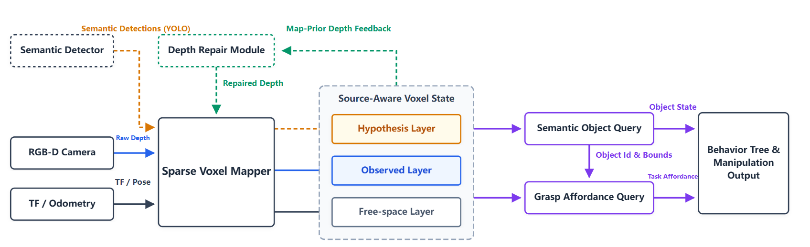

Semantic Voxels sits between perception and action.  
It turns RGB-D observations into a world state that a robot can actually use.

---

## Repository Status

This repository is currently a project archive, demo record, and technical-report companion for Semantic Voxels.

Current status:

- ROS 2 Semantic Voxels mapping module implemented.
- C++ voxel mapping core implemented.
- Python prototype / reference modules included.
- Semantic bridge and hypothesis update path implemented.
- Object query and grasp candidate query services implemented.
- Depth-failure and semantic completion demos recorded.
- arXiv-style technical report draft prepared for timestamping and method archival.

The first public release is intentionally conservative. Some code, scripts, and launch files are still being cleaned, reorganized, and documented.

**Planned full open-source release: September 2026.**

---

## Development Setup and Edge-Compute Note

Semantic Voxels was developed and demonstrated on a regular lightweight laptop / mini-PC class machine, not on a high-end GPU workstation:

- OS: Ubuntu 24.04.2 LTS
- Kernel: 6.17
- CPU: 13th Gen Intel Core i5-1335U
- RAM: 16 GB
- GPU: Intel UHD Graphics integrated GPU
- NVIDIA discrete GPU: none

In other words, the current demos are not relying on a large NVIDIA workstation. The Semantic Voxels mapping core is mainly built around a CPU-side C++ implementation, with the goal of providing real-time, queryable, and explainable semantic voxel world state under edge-robot compute constraints.

This is not presented as a formal performance benchmark yet. More rigorous measurements of latency, CPU usage, memory usage, and cross-hardware behavior are left for future technical reports or paper experiments.

Still, the fact that such a small and modest computer can run a large mapping demo is a kind of evidence in itself.

---

**The current public technical report does not claim completed real-robot grasping experiments. Real-robot validation is planned as future work.**

## What Semantic Voxels Is Not

Semantic Voxels is not:

- a full SLAM backend
- a replacement for RTAB-Map, Nav2, or MoveIt
- a photorealistic neural scene representation
- a general optimal grasp planner
- a claim of completed real-robot closed-loop validation

Semantic Voxels is a representation layer: it organizes online perception into a source-aware, queryable, task-facing robot world state.

---

## Summary

**Semantic Voxels is a mapping method that lets robots remember what they observed, mark what they inferred, forget what moved, and query what they can act on next.**
